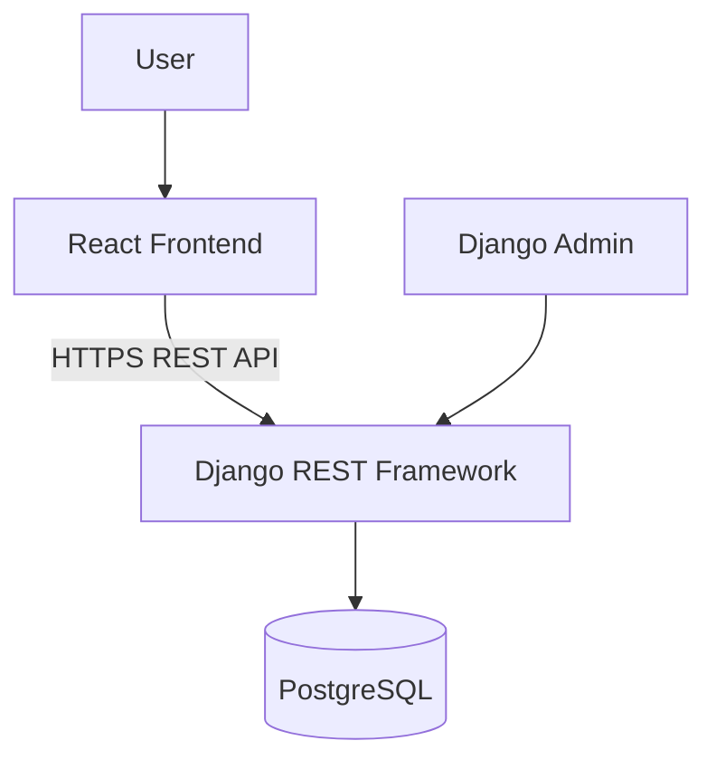

# Guitar Chords

A full-stack guitar songbook application for browsing songs, learning guitar chords, and practicing music through an interactive, responsive interface.

Built with React, Django REST Framework, and PostgreSQL.

## Live Deployment

- [Live Application](https://guitar-chords-two.vercel.app/)
- [Backend API](https://guitar-chords.onrender.com/api/health/)
- [API Documentation](https://guitar-chords.onrender.com/api/docs/)

## Features

### Songbook

- Search songs by title and artist
- Filter songs by language
- Support for Nepali, Hindi, and English
- ChordPro-based song rendering
- Interactive chord transposition
- Adjustable auto-scroll
- Favorites with persistent local storage
- Capo, tuning, and strumming information

### Chord Library

- 39 guitar chord definitions
- Interactive chord diagrams
- Finger placement and fret information
- Chord category filtering

### User Interface

- Responsive desktop and mobile layouts
- Light and dark themes
- Loading, error, and empty states
- Client-side routing

### Backend

- RESTful API using Django REST Framework
- PostgreSQL relational database
- Filtering, searching, ordering, and pagination
- Django Admin for catalogue management
- Song publication and visibility controls
- OpenAPI documentation
- Automated visibility tests

## Technology Stack

| Layer | Technologies |
|---|---|
| Frontend | React, Vite, Tailwind CSS |
| Backend | Python, Django, Django REST Framework |
| Database | PostgreSQL |
| API Client | Axios |
| Icons | Lucide React |
| Containerization | Docker, Docker Compose |
| Web Server | Gunicorn, WhiteNoise |
| CI | GitHub Actions |
| Frontend Hosting | Vercel |
| Backend Hosting | Render |
| Database Hosting | Neon |

## Architecture



The frontend and backend are independently deployed.
Django manages application logic, data validation,
database relationships, and catalogue visibility.

## Project Structure

```text
guitar-chords/
├── backend/
│   ├── config/
│   ├── songs/
│   ├── chords/
│   ├── Dockerfile
│   ├── manage.py
│   └── requirements.txt
├── frontend/
│   ├── src/
│   ├── public/
│   ├── package.json
│   └── vercel.json
├── .github/
│   └── workflows/
│       └── ci.yml
├── compose.yaml
├── .gitignore
└── README.md
```

## Local Development

### Prerequisites

- Python 3.14
- Node.js 22
- PostgreSQL
- Git
- Docker Desktop (optional)

### Clone the Repository

```bash
git clone https://github.com/roshan13ghimire/guitar-chords.git
cd guitar-chords
```

### Backend Setup

```bash
cd backend
python -m venv .venv
```

Activate the virtual environment on Windows:

```powershell
.\.venv\Scripts\Activate.ps1
```

Install dependencies:

```bash
pip install -r requirements.txt
```

Create a local PostgreSQL database and configure
the backend environment variables using `.env.example`
as a reference.

```bash
python manage.py migrate
python manage.py seed_chords
python manage.py expand_chords
python manage.py createsuperuser
python manage.py runserver 127.0.0.1:8000
```

Backend: http://localhost:8000

Admin: http://localhost:8000/admin/

### Frontend Setup

Open another terminal:

```bash
cd frontend
npm ci
```

Create `frontend/.env`:

```env
VITE_API_BASE_URL=http://localhost:8000/api
```

Start the development server:

```bash
npm run dev
```

Frontend: http://localhost:5173

## Docker Setup

Create a `.env.docker` file in the project root
with locally generated values for:

```env
DOCKER_DB_PASSWORD=your-local-database-password
DOCKER_SECRET_KEY=your-local-secret-key
```

Build and start the backend and PostgreSQL containers:

```bash
docker compose --env-file .env.docker up -d --build
```

Check container status:

```bash
docker compose --env-file .env.docker ps
```

The Dockerized backend is available at:

http://localhost:8001

Stop the containers:

```bash
docker compose --env-file .env.docker down
```

## API Endpoints

| Method | Endpoint | Description |
|---|---|---|
| GET | `/api/health/` | API health check |
| GET | `/api/songs/` | Browse accessible songs |
| GET | `/api/songs/{slug}/` | Song details |
| GET | `/api/artists/` | Browse accessible artists |
| GET | `/api/chords/` | Guitar chord library |

The public API provides read-only access.
Catalogue management is handled through Django Admin.

## Testing

### Backend

```bash
cd backend
python manage.py check
python manage.py test
python manage.py makemigrations --check --dry-run
```

### Frontend

```bash
cd frontend
npm run lint
npm run build
```

## Continuous Integration

GitHub Actions runs automated checks on pushes and
pull requests to the main branch.

The workflow includes:

- PostgreSQL test database provisioning
- Django system checks
- Migration validation
- Backend automated tests
- Static file collection
- Frontend linting
- Production build verification

## Deployment

The application uses independently deployed services:

- Vercel for the React frontend
- Render for the Dockerized Django backend
- Neon for managed PostgreSQL

Production and development databases are isolated.

Sensitive configuration is managed through environment
variables and excluded from version control.

## Content and Copyright

Guitar Chords is a personal songbook and software
engineering project.

Third-party song content remains subject to the rights
of its respective copyright holders.

Private song records are excluded from the public API.
Only content authorized for public distribution should
be published.

The source repository does not include the private
song catalogue or database exports.

## Author

Roshan Ghimire

Software Engineer | Full-Stack Developer

- [Portfolio](https://www.roshanghimiree.com.np/)
- [GitHub](https://github.com/roshan13ghimire)
